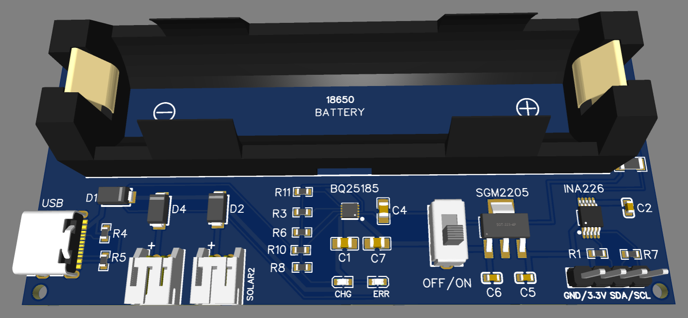

# solar-pmu

Solar power management unit designed for ultra-low power IoT

It features a dedicated Li-ion charger with dynamic power path management, an integrated 18650 cell holder, a regulated 3.3V output, and real-time I2C power monitoring.

## Features

* **PMIC / Charger**: BQ25185
* **Battery:** Onboard single 18650 Li-ion holder
* **Voltage Regulator:** SGM2205
* **Power Monitoring**: INA226

## Status LEDs

The `LED_CHG` and `LED_ERR` indicators are driven by the BQ25185 open-drain status outputs. They turn on when their corresponding status pin is LOW.

| Charger state | `LED_CHG` (`STAT2`) | `LED_ERR` (`STAT1`) |
|---|---|---|
| Charging in progress | On | Off |
| Charge complete, charger asleep, or charging disabled | Off | Off |
| Recoverable fault (for example, input overvoltage or battery temperature fault) | Off | On |
| Non-recoverable or latched fault (for example, the 6-hour safety timer has expired) | On | On |

With no battery connected, `LED_CHG` may blink as the charger alternates between charging and charge-complete states. See the [BQ25185 datasheet](https://www.ti.com/lit/ds/symlink/bq25185.pdf) for details.
